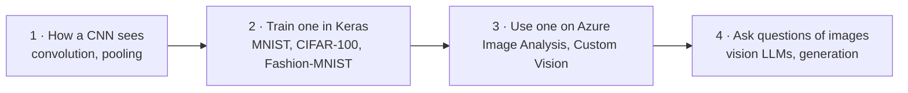

# CNNs and Computer Vision with LLMs and Azure

A lecture with six hands-on labs. It starts with one convolution written by hand and ends with asking a multimodal LLM why the traffic has stopped.



## Learning objectives

After this lecture you can:

1. Explain convolution, ReLU and pooling, and compute a layer's output size and weight count by hand.
2. Build, train and evaluate a CNN in Keras, and read its training curves for overfitting.
3. Call Azure AI Vision to analyse an image, and train a custom classifier with Azure Custom Vision from a handful of photos.
4. Describe how a vision-language model turns an image into tokens, and query one locally (Ollama) and on Azure OpenAI.
5. Choose between a CNN, a prebuilt API, a custom-trained service and a vision LLM for a given problem.

## Agenda

Sized for one 2.5-hour session. Parts 1–2 and 3–4 also work as two 75-minute sessions.

| Time | Part | Notes | Slides | Lab |
|---|---|---|---|---|
| 0:00 | Recap: layers, loss, optimizer, activation functions | — | [Computer-Vision-101](slides/Computer-Vision-101.pptx) 1–4 | — |
| 0:10 | **1 · How a network learns to see** | [01-cnn-theory](lecture/01-cnn-theory.md) | [CNN-Theory](slides/CNN-Theory.pptx) | [Lab 1 · CNN 101](labs/01-cnn-101) (15 min) |
| 0:50 | **2 · CNNs in Keras** | [02-cnn-in-keras](lecture/02-cnn-in-keras.md) | [Computer-Vision-101](slides/Computer-Vision-101.pptx) 9–19 | [Lab 2 · Keras CNNs](labs/02-keras-cnn) (25 min, finish as homework) |
| 1:25 | Break | | | |
| 1:35 | **3 · Computer vision on Azure** | [03-azure-vision](lecture/03-azure-vision.md) | [Computer-Vision-101](slides/Computer-Vision-101.pptx) 7, 20–21, 30–33 | [Lab 3 · Image Analysis](labs/03-azure-image-analysis) (10 min) · [Lab 4 · Custom Vision](labs/04-azure-custom-vision) (15 min) |
| 2:05 | **4 · Computer vision with LLMs** | [04-vision-llms](lecture/04-vision-llms.md) | [Computer-Vision-101](slides/Computer-Vision-101.pptx) 8, 22–29 | [Lab 5 · Vision LLMs](labs/05-vision-llms) (15 min) · [Lab 6 · Image generation](labs/06-image-generation) (homework) |
| 2:25 | Wrap-up: which tool for which problem | [04 §4.6](lecture/04-vision-llms.md#46-choosing-a-tool) | | |

## Labs

| # | Lab | You will | Needs |
|---|---|---|---|
| 1 | [CNN 101](labs/01-cnn-101) | Code a 3×3 convolution and 2×2 max pooling in plain Python | NumPy, scikit-image |
| 2 | [Keras CNNs](labs/02-keras-cnn) | Train CNNs on MNIST, CIFAR-100 and Fashion-MNIST; classify your own handwriting | TensorFlow |
| 3 | [Azure Image Analysis](labs/03-azure-image-analysis) | Get tags, captions and landmarks from a REST API | Azure Computer Vision key |
| 4 | [Azure Custom Vision](labs/04-azure-custom-vision) | Train an apple-vs-banana classifier in the portal and call it from Python | Azure account |
| 5 | [Vision LLMs](labs/05-vision-llms) | Compare two multimodal models on the same photo; optional Azure OpenAI | Ollama |
| 6 | [Image generation](labs/06-image-generation) | Generate, vary and mask-edit images | OpenAI API key |

## Setup

```bash
git clone https://github.com/iportilla/CNN.git
cd CNN
python -m venv .venv && source .venv/bin/activate
pip install -r requirements.txt
cp .env.example .env    # then add your keys
jupyter lab
```

Labs 1 and 2 need no keys or accounts. Labs 3–6 read credentials from `.env`; see each lab's README. Do not commit `.env`.

## Repository layout

```
lecture/   Lecture notes, one file per part
slides/    PowerPoint decks
labs/      Six labs: notebooks, READMEs, solutions
images/    Sample photos used by Labs 3–5
```

## Credits and further reading

- MIT 6.S191 Introduction to Deep Learning, Lecture 3: Deep Computer Vision — [slides](http://introtodeeplearning.com/slides/6S191_MIT_DeepLearning_L3.pdf) · [introtodeeplearning.com](http://introtodeeplearning.com)
- Stanford CS231n — [cs231n.github.io](https://cs231n.github.io/)
- Google codelab — [Build convolutions and perform pooling](https://developers.google.com/codelabs/tensorflow-3-convolutions)
- Microsoft Learn — [Azure AI Vision](https://learn.microsoft.com/azure/ai-services/computer-vision/overview) · [Custom Vision](https://learn.microsoft.com/azure/ai-services/custom-vision-service/overview) · [Azure AI Search](https://learn.microsoft.com/azure/search/search-what-is-azure-search)
- The Lab 6 notebook is adapted from the OpenAI Cookbook. Sample photos in `images/` are third-party and included for classroom use only.

Code and notes: MIT License, see [LICENSE](LICENSE).
