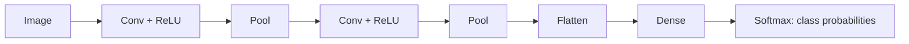
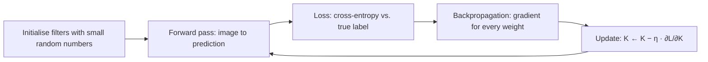

# Part 1 — How a network learns to see

Slides: [`slides/CNN-Theory.pptx`](../slides/CNN-Theory.pptx) · Lab: [`labs/01-cnn-101`](../labs/01-cnn-101)

Computer vision is the field of AI that lets computers interpret images and video: photo search, checkout-free retail, driver assistance, medical imaging, passport gates. For most of the last decade the engine behind it has been the convolutional neural network (CNN).

## 1.1 Why not a plain neural network?

Recap of any neural network: input → layers of weights → prediction → loss against the true label → optimizer adjusts the weights. Nothing about that loop changes for images. What changes is the shape of the layers.

A dense (fully connected) layer has two problems with images.

| | Dense layer | Convolutional layer |
|---|---|---|
| Weights to connect a 256×256 grayscale image to 1,000 hidden units | 65,536 × 1,000 = **65.5 million** | — |
| Weights for 32 filters of size 3×3 on an image of any size | — | 32 × (3·3 + 1) = **320** |
| Knows which pixels are neighbours | No, the image is flattened | Yes |

The second row matters as much as the first. Edges, textures and shapes are made of *neighbouring* pixels, and flattening throws that layout away.

## 1.2 Three ideas behind every CNN

1. **Local connectivity.** Each unit looks at a small patch, such as 3×3 pixels.
2. **Parameter sharing.** The same filter weights are reused at every position, so a feature learned in one corner is recognised anywhere.
3. **Hierarchy.** Layers are stacked, so edges combine into textures, textures into parts, parts into objects.



## 1.3 Convolution

A filter (kernel) is a small matrix. Slide it over the image; at each position multiply the patch by the filter element by element and add up the products. Each sum is one pixel of the output **feature map**.

$$S(x,y) = \sum_{i}\sum_{j} I(x+i,\,y+j)\cdot K(i,j)$$

Worked example. The image is dark on the left (0) and bright on the right (9). The filter is Sobel X.

```
Image patch      Filter (Sobel X)
0  0  9          -1  0  1
0  0  9     *    -2  0  2     =  (0+0+9) + (0+0+18) + (0+0+9) = 36
0  0  9          -1  0  1
```

The filter subtracts the left column from the right, so it responds strongly where brightness changes left to right: a vertical edge. Over a flat region the answer is 0.

Different numbers detect different things:

| Filter | Values | Responds to |
|---|---|---|
| Sobel X | `[[-1,0,1],[-2,0,2],[-1,0,1]]` | Vertical edges |
| Sobel Y | `[[-1,-2,-1],[0,0,0],[1,2,1]]` | Horizontal edges |
| Laplacian | `[[0,1,0],[1,-4,1],[0,1,0]]` | Edges in every direction |
| Gaussian blur | `[[1,2,1],[2,4,2],[1,2,1]] / 16` | Nothing: it smooths noise |

> **The key idea.** Those four filters were designed by hand. In a CNN, every filter value is a weight the network learns. The sliding-window arithmetic is identical; the only change is who chooses the numbers.

**Do now:** [Lab 1](../labs/01-cnn-101) implements this loop in plain Python on a 512×512 photo. Swap the filter and re-run.

## 1.4 Stride, padding and layer size

- **Stride** `S`: how far the filter moves each step.
- **Padding** `P`: a border of zeros so the filter can sit on edge pixels.

Output width for input width `W` and filter width `K`:

$$O = \left\lfloor \frac{W - K + 2P}{S} \right\rfloor + 1$$

With no padding a 3×3 filter shrinks each side by 2, which is why Keras reports 28 → 26.

Weights in a convolutional layer with `C_in` input channels and `C_out` filters:

$$(K \cdot K \cdot C_{in} + 1)\cdot C_{out}$$

| Layer | Weights |
|---|---|
| 3×3, 1 → 32 channels | (9·1 + 1)·32 = 320 |
| 3×3, 32 → 64 channels | (9·32 + 1)·64 = 18,496 |
| 3×3, 64 → 64 channels | (9·64 + 1)·64 = 36,928 |

The count depends on filter size and channels, never on image size.

## 1.5 ReLU

$$\mathrm{ReLU}(x) = \max(0, x)$$

Negative responses become zero; positive ones pass through. Without a non-linearity between them, ten convolution layers collapse into one linear filter, because a linear function of a linear function is still linear. ReLU is what lets depth build complexity.

## 1.6 Pooling

2×2 max pooling with stride 2 keeps the largest value in each non-overlapping 2×2 block.

```
1 3 | 2 1
4 6 | 5 0        6 5
----+----   →    7 9
7 2 | 9 8
1 0 | 3 4
```

- Height and width halve, so later layers process a quarter of the values.
- The maximum records that the feature was found somewhere in the block.
- Shifting a feature by a pixel inside its block does not change the output.

## 1.7 A complete CNN

The model in [`CNN-example.ipynb`](../labs/02-keras-cnn/CNN-example.ipynb), trained on MNIST handwritten digits:

| Layer | Output shape | Weights |
|---|---|---|
| Input | 28 × 28 × 1 | 0 |
| Conv 3×3, 32 filters + ReLU | 26 × 26 × 32 | 320 |
| MaxPool 2×2 | 13 × 13 × 32 | 0 |
| Conv 3×3, 64 filters + ReLU | 11 × 11 × 64 | 18,496 |
| MaxPool 2×2 | 5 × 5 × 64 | 0 |
| Conv 3×3, 64 filters + ReLU | 3 × 3 × 64 | 36,928 |
| Flatten | 576 | 0 |
| Dense 64 + ReLU | 64 | 36,928 |
| Dense 10 + softmax | 10 | 650 |
| **Total** | | **93,322** |

Two trends to notice: height and width shrink (28 → 3) while channels grow (1 → 64). The network trades *where* for *what*.

**Check yourself:** use the formulas in 1.4 to reproduce any row.

## 1.8 What the layers learn

| Depth | Typical features |
|---|---|
| Layer 1 | Edges, colours, orientations |
| Layer 2 | Corners, blobs, textures such as fur or brick |
| Middle | Parts: eyes, wheels, windows |
| Deep | Whole objects: faces, cars, buildings |

Nobody tells the network to learn edges first. It emerges because each layer can only combine what the one before it detected, and because the **receptive field** grows with depth: three stacked 3×3 convolutions see 3×3, then 5×5, then 7×7 pixels of the original image, and pooling widens that further.

First-layer filters of a trained CNN usually look like the Sobel and Gabor filters engineers designed by hand decades earlier. See [`labs/01-cnn-101/filters.md`](../labs/01-cnn-101/filters.md).

## 1.9 How the filters are learned



`η` is the learning rate. The loop repeats over many batches until the loss stops falling. Because one filter is shared across the whole image, its gradient is the sum of the gradients from every position it touched.

## 1.10 Keeping a CNN from memorising

The warning sign is training accuracy that keeps rising while validation accuracy flattens or falls.

| Where | Technique | What it does |
|---|---|---|
| In the network | Dropout | Switches off a random fraction of units each training step |
| In the data | Augmentation | Trains on flipped, shifted, rotated, cropped copies |
| In the starting point | Transfer learning | Reuses filters trained on a large dataset; retrains only the last layers |

Transfer learning is what makes Azure Custom Vision in [Part 3](03-azure-vision.md) work with a handful of images.

## 1.11 Four decades in five models

| Year | Model | Why it matters |
|---|---|---|
| 1980 | Neocognitron (Fukushima) | Layered local feature detectors inspired by the visual cortex; no good way to train it |
| 1998 | LeNet-5 (LeCun) | CNN trained by backpropagation to read digits on cheques; about 60 thousand weights |
| 2012 | AlexNet | Won ImageNet with 15.3% top-5 error, far ahead of the field; 8 layers, 60 million weights, GPUs |
| 2014 | VGG-16 | Depth with small 3×3 filters; 13 conv layers, 138 million weights |
| 2015 | ResNet | Skip connections allow 152 layers; 3.6% top-5 error, below the estimated human rate of about 5% |

The theory changed little between 1998 and 2012. What changed was data (ImageNet) and compute (GPUs).

## Remember

1. A convolution is a small filter slid across the image, giving a feature map.
2. Sharing one filter across all positions keeps the weight count small.
3. ReLU makes the network non-linear; pooling makes it smaller and shift-tolerant.
4. Stacked layers build edges into textures, parts and whole objects.
5. The filter values are learned from data by backpropagation.

## Further reading

- MIT 6.S191, Lecture 3: Deep Computer Vision — [slides](http://introtodeeplearning.com/slides/6S191_MIT_DeepLearning_L3.pdf), [course site](http://introtodeeplearning.com)
- Stanford CS231n — [Convolutional Neural Networks for Visual Recognition](https://cs231n.github.io/)
- Google codelab — [Build convolutions and perform pooling](https://developers.google.com/codelabs/tensorflow-3-convolutions)
- LeCun et al. (1998) — [Gradient-Based Learning Applied to Document Recognition](http://yann.lecun.com/exdb/publis/pdf/lecun-01a.pdf)

Next: [Part 2 — CNNs in Keras](02-cnn-in-keras.md)
