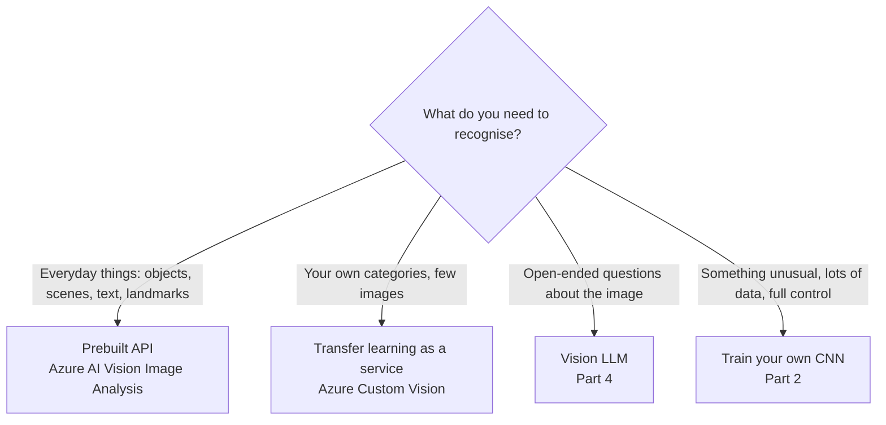

# Part 3 — Computer vision on Azure

Labs: [`labs/03-azure-image-analysis`](../labs/03-azure-image-analysis) · [`labs/04-azure-custom-vision`](../labs/04-azure-custom-vision)

In Part 2 you trained a CNN. Most teams never do. They call a model somebody else trained, or fine-tune one with a few of their own images. Azure offers both.

## 3.1 Three ways to get a vision model



| | Prebuilt API | Custom Vision | Your own CNN |
|---|---|---|---|
| Training data you supply | None | From 5 images per tag | Thousands |
| ML skill needed | Call a REST endpoint | Upload and tag in a portal | Build, train, tune |
| Labels | Microsoft's | Yours | Yours |
| Where it runs | Azure | Azure, or exported to edge | Anywhere |

## 3.2 Azure AI Vision: Image Analysis

One HTTPS call. You send image bytes (or a URL) and name the features you want; you get JSON back.

```python
analyze_url = f"{endpoint}vision/v3.2/analyze"
headers = {"Ocp-Apim-Subscription-Key": key, "Content-Type": "application/octet-stream"}
params  = {"visualFeatures": "Categories,Description,Color,Tags"}

with open("images/450px-Broadway_and_Times_Square_by_night.jpg", "rb") as f:
    analysis = requests.post(analyze_url, headers=headers, params=params, data=f).json()
```

What the lab notebook got back:

| Image | Feature | Result |
|---|---|---|
| Times Square at night | `Tags` | `building 0.99`, `metropolis 0.94`, `metropolitan area 0.94`, `downtown 0.93`, `outdoor 0.92` … |
| Times Square at night | `Categories` | `outdoor_street 0.40` |
| Eiffel Tower | `Categories` + landmark detail | `building_ 0.93`, landmark **Eiffel Tower 0.97** |
| Any | `Description` | One-sentence caption with a confidence |

Read the output the way you read a softmax layer: a tag is a class, the confidence is its score. The difference from your Lab 2 model is scale. The service has thousands of labels and was trained on far more images than you will ever collect.

Things to know:

- **Key and endpoint** come from a Computer Vision resource in the Azure portal. Keep them in `.env`, never in the notebook.
- **API versions.** The lab uses the v3.2 REST API. The newer Image Analysis 4.0 API adds dense captions, people detection and better OCR. Microsoft is steering these workloads toward its multimodal foundation models, so check the [current documentation](https://learn.microsoft.com/azure/ai-services/computer-vision/overview) for lifecycle dates before building something long-lived.
- **Try without code:** [Vision Studio](https://portal.vision.cognitive.azure.com/gallery/imageanalysis).

**Class exercise.** Run the notebook on `images/nyc-street.jpg`. Which tags are right? Which obvious things are missing? Keep the JSON; you will compare it with a vision LLM in Part 4.

## 3.3 Azure Custom Vision

Image Analysis cannot tell a hemlock from a Japanese cherry, or a ripe banana from a green one, because nobody trained it on those labels. Custom Vision lets you add your own with very little data.

It is transfer learning with a user interface (Part 1 §1.10): Microsoft keeps the convolutional layers of a pretrained network and retrains only the final classifier on your images.

Workflow at [customvision.ai](https://www.customvision.ai/):

1. Create Custom Vision **training** and **prediction** resources.
2. Create a project: *Classification*, *Multiclass*, domain *General*.
3. Upload images and tag them. Minimum 5 per tag; aim for 30 or more.
4. Train.
5. Evaluate: precision, recall, and the Quick Test tab.
6. Optional: publish the iteration to get a prediction endpoint you can call from code.

### Reading the evaluation

| Metric | Question it answers |
|---|---|
| **Precision** | Of the images the model called *apple*, how many were apples? |
| **Recall** | Of the real apples, how many did the model find? |
| **Probability threshold** | How sure must the model be before it counts as a prediction? Raising it trades recall for precision. |

With 5 images per tag these numbers are computed on one or two held-out images, so they jump around. That is a lesson in itself: a metric is only as reliable as the test set behind it.

[Lab 4](../labs/04-azure-custom-vision) builds an apple-vs-banana classifier from the photos in `images/` and calls it from Python.

Microsoft has announced a retirement timeline for Custom Vision, so check the documentation before depending on it. For new production work Microsoft points to Azure Machine Learning AutoML for images and to multimodal models; for learning how transfer learning behaves, it is still the quickest tool there is.

## 3.4 Beyond labels: searching images

A classifier maps an image to a label. An **embedding** model maps an image to a vector, such that similar images land close together. Store the vectors in Azure AI Search and you can find images by example, or by text if the embedding model was trained on image-text pairs.

```python
query_vector = get_image_embedding(query_image)
results = search_client.search(
    search_text=None,
    vector_queries=[VectorizedQuery(vector=query_vector, k_nearest_neighbors=3, fields="image_vector")],
)
```

The vector usually comes from the layer just before the classifier of a CNN or vision transformer: the same feature maps you met in Part 1, flattened and used directly instead of being turned into a class. Part 4 explains where text-aligned embeddings come from.

## 3.5 Discussion

1. A grocery chain wants to detect empty shelves. Prebuilt API, Custom Vision, or its own CNN? What would change your answer?
2. Your Custom Vision model has 100% precision and 60% recall for *banana*. Describe in plain words what it is doing wrong.
3. Image Analysis returned `outdoor_street 0.40`. Is 0.40 high or low? What would you need to know to decide?

Next: [Part 4 — Computer vision with LLMs](04-vision-llms.md)
