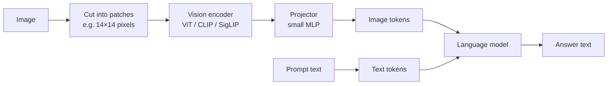

# Part 4 — Computer vision with LLMs

Labs: [`labs/05-vision-llms`](../labs/05-vision-llms) · [`labs/06-image-generation`](../labs/06-image-generation)

## 4.1 From labels to questions

Look at [`images/nyc-street.jpg`](../images/nyc-street.jpg).


A classifier or tagging API can tell you: *street, taxi, person, building, bicycle*. Now try these:

- Why are the people walking while the cars are not moving?
- Is it a hot day?
- Is it a dangerous environment? Why is an adult holding a child's hand?
- Is this in the US? Which city?
- What time of day is it?
- Is it OK to ride a bike here?
- Is there a party in the middle of the street? (Find the balloons.)
- What year is it? Which direction is north?

None of these is a label. Answering them needs recognition **plus** knowledge of the world **plus** reasoning, and a few cannot be answered from the image at all. This is the gap vision-language models (VLMs) fill: the image goes in alongside a prompt, and the question is yours to choose.

## 4.2 How an LLM sees

An LLM processes a sequence of token vectors. To make it see, turn the image into token vectors too.



**Step 1 — patches.** A vision transformer (ViT) cuts the image into a grid of small squares and turns each into a vector with one learned linear map. That map is a convolution whose stride equals its kernel size, so the first layer of a ViT is the operation you coded by hand in Lab 1.

**Step 2 — vision encoder.** Transformer layers let every patch attend to every other patch. Where a CNN grows its receptive field layer by layer, a ViT sees the whole image from the first layer. CNNs build in the assumption that nearby pixels matter most; ViTs have to learn it, which is why they need more data and why they win when data is plentiful.

**Step 3 — aligning images with language.** CLIP (OpenAI, 2021) trained an image encoder and a text encoder together on 400 million image-caption pairs, pulling each image's vector toward the vector of its own caption and away from the others. Afterwards, images and text live in one shared space. This is what makes text-to-image search in Part 3 §3.4 work, and it gives a VLM a vision encoder whose outputs already mean something in words.

**Step 4 — projector and LLM.** A small network maps the vision encoder's outputs into the LLM's token space. The LLM then reads image tokens and text tokens as one sequence. LLaVA-1.5, for example, turns a 336×336 image into 24 × 24 = 576 image tokens.

| | CNN classifier (Part 2) | Vision LLM |
|---|---|---|
| Input | Image | Image + prompt |
| Output | One of N fixed classes, with probabilities | Free text |
| Weights | Tens of thousands to millions | Billions |
| New task | Collect data, retrain | Change the prompt |
| Speed | Milliseconds | Seconds |
| Failure mode | Wrong label, often with low confidence | Fluent, confident, wrong |

## 4.3 Running one

**Locally with Ollama.** Free, private, runs on a laptop.

```python
import ollama

response = ollama.chat(
    model="gemma3",
    messages=[{
        "role": "user",
        "content": "Why are the people walking while the cars are not moving?",
        "images": ["images/nyc-street.jpg"],
    }],
)
print(response["message"]["content"])
```

**Hosted on Azure OpenAI.** Larger models, nothing to install. The image travels as a base64 data URL inside the chat message.

```python
client.chat.completions.create(
    model=deployment,
    messages=[{"role": "user", "content": [
        {"type": "text", "text": "Why are the people walking while the cars are not moving?"},
        {"type": "image_url", "image_url": {"url": f"data:image/jpeg;base64,{b64}"}},
    ]}],
)
```

[Lab 5](../labs/05-vision-llms) sends the same questions to two local models side by side, then optionally to Azure OpenAI.

## 4.4 The question ladder

Use this ladder in the lab. VLMs get less reliable as you climb.

| Rung | Example | Typical behaviour |
|---|---|---|
| Describe | "Describe this picture." | Strong |
| Read | "What street is this?" (signs say E 11 St) | Good on large, clear text |
| Count | "How many yellow taxis?" | Weak; answers vary between models |
| Infer | "Why are the cars stopped?" | Often good, but check the evidence it cites |
| Unknowable | "What year is it?" | Should say it cannot tell; often guesses |

Prompting habits that help:

- Ask for the evidence: *"What in the picture tells you?"*
- Give permission to decline: *"If the image does not show this, say so."*
- Ask for structure when code will read the answer: *"Respond with JSON only."*
- One question at a time.

## 4.5 Limits

- **Hallucination.** The model produces plausible text whether or not the pixels support it.
- **No calibrated confidence.** Azure Image Analysis returns `building 0.99`. A VLM returns a sentence.
- **Small detail.** Images are downscaled before encoding, so small text and distant objects are lost.
- **Counting and spatial relations** remain weak spots.
- **Cost and latency.** Hundreds of image tokens per picture; seconds per answer.
- **Privacy.** A hosted model receives the image. People, plates and screens in the frame go with it.

## 4.6 Choosing a tool

| You need to… | Reach for |
|---|---|
| Sort millions of images into a few known classes, fast | A CNN (Part 2) or Custom Vision (Part 3) |
| Tag everyday content with scores you can threshold | Azure Image Analysis (Part 3) |
| Recognise your own categories from a few examples | Custom Vision (Part 3) |
| Answer open questions, explain a scene, extract fields from a messy document | A vision LLM |
| Find similar images | Embeddings + vector search (Part 3 §3.4) |

Many real systems chain them: a cheap classifier filters, and a VLM handles the cases that need explanation.

## 4.7 The other direction: generating images

Understanding goes image → text. Generation goes text → image. The current models are diffusion-based: they start from noise and remove it step by step, steered by an encoding of your prompt.

[Lab 6](../labs/06-image-generation) uses the OpenAI Images API to:

- **Generate** an image from a prompt.
- Produce **variations** by generating again with the same prompt.
- **Edit** part of an image using a mask: transparent pixels in the mask are regenerated, the rest is kept.

**Design exercise.** Design a sneaker for college students (18 to 24: campus life, comfort, sustainability, bold style).

1. Write a first prompt. Name materials (mesh, recycled leather), features (translucent sole, gradient colour), setting (urban campus) and style (photorealistic, product photography).
2. Generate two or three images. Does the result fit the audience? Are the material, angle and setting right?
3. Revise one thing at a time: an adjective, the angle, the background, the palette. Keep a log of prompt → result.

The skill being practised is the same as in §4.4: say precisely what you want, look critically at what came back, and iterate.

## 4.8 Discussion

1. In Lab 5, which question produced the biggest disagreement between the two models? Who was right, and how do you know?
2. A hospital wants to use a VLM to read chest X-rays. Which of the limits in §4.5 worries you most?
3. Your Lab 2 CNN reads a digit with 93,322 weights. A VLM does it with billions. When is the VLM still the right choice?

Back to the [lecture overview](../README.md)
